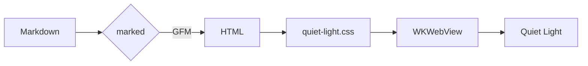
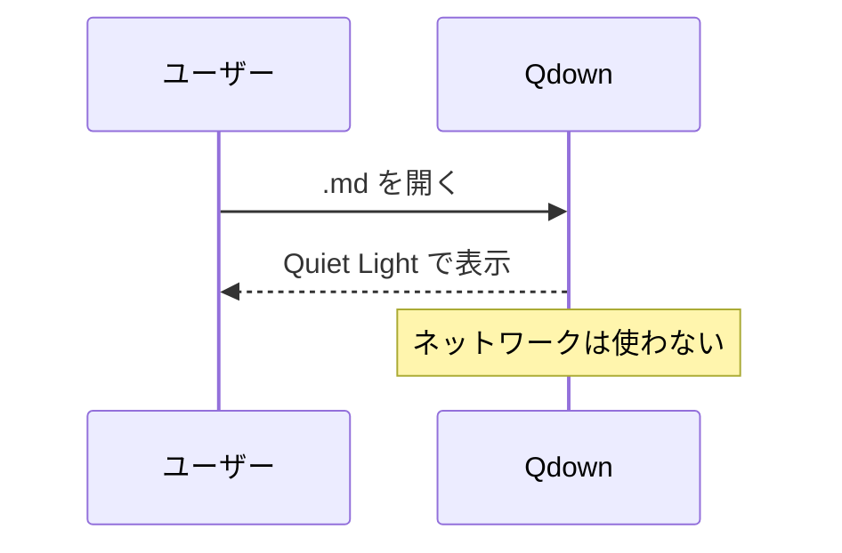
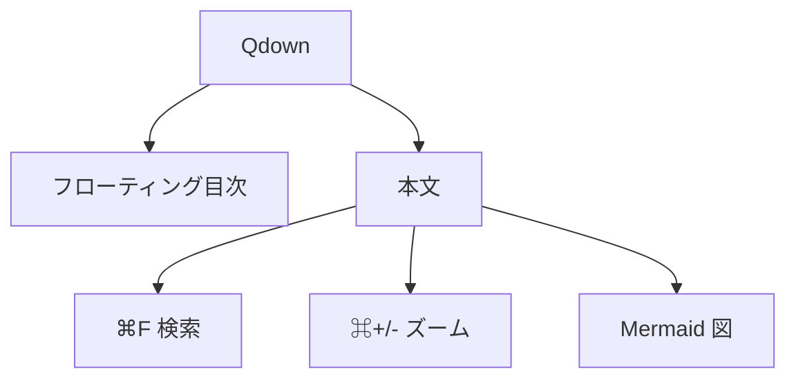

# Qdown サンプル

Qdown は Quiet Light テーマ専用の、窓型 macOS Markdown ビューアです。このファイルは表示確認用のサンプルで、見出し・表・タスクリスト・コードブロック・引用・Mermaid 図を含みます。

## 見出しとテキスト

### 強調とインラインコード

**太字**、*斜体*、~~打ち消し線~~、そしてインラインコード `qdown://doc/` を含む段落です。日本語の文章が読みやすい行間で折り返されることを確認します。長い英文も混ぜます: The quick brown fox jumps over the lazy dog, again and again, until the line wraps naturally inside the content column.

#### 見出しレベル4

見出しレベル 4 の本文です。右端のフローティング目次では h1 から h6 までが階層表示されます。

##### 見出しレベル5

見出しレベル 5 の本文です。

###### 見出しレベル6

見出しレベル 6 の本文です。ここまでが目次の対象です。

## リスト

- 箇条書きの項目
  - ネストした項目
  - もうひとつのネスト
- 三つ目の項目
  1. 番号付きのネスト
  2. 番号付きのネスト 2

1. 順序付きリスト
2. 二番目
3. 三番目

## タスクリスト

- [x] marked で GFM を描画する
- [x] highlight.js でコードを色付けする
- [ ] Mermaid の配色を確認する
- [ ] Intel Mac と M1 Mac で起動する

## 表

| 機能 | 状態 | 備考 |
| --- | --- | --- |
| フローティング目次 | 実装 | h1–h6 を階層表示 |
| 検索 | 実装 | ⌘F / ⌘G / ⇧⌘G |
| Mermaid | 実装 | base テーマ + Quiet Light 変数 |
| ズーム | 実装 | ⌘+ / ⌘− / ⌘0、再起動後も保持 |
| ローカル画像 | 実装 | ファイル相対、Web 画像は不可 |

## 引用

> Quiet Light は VS Code 組み込みテーマの色をそのまま使い、
> 紫寄せのアクセントだけを意図的に加えています。
>
> > ネストした引用もこのとおり表示されます。

## コードブロック

```swift
struct ZoomStore {
    static let steps: [Double] = [0.5, 1.0, 1.25, 1.5, 2.0]

    var zoom: Double {
        didSet { UserDefaults.standard.set(zoom, forKey: "QdownPageZoom") }
    }
}
```

```javascript
function findMatches(text, query) {
  const needle = query.toLocaleLowerCase();
  const haystack = text.toLocaleLowerCase();
  const matches = [];
  let from = 0;
  while (true) {
    const at = haystack.indexOf(needle, from);
    if (at === -1) break;
    matches.push(at);
    from = at + needle.length;
  }
  return matches;
}
```

```json
{
  "theme": "quiet-light",
  "background": "#F0F0F7",
  "purple": "#705697",
  "mermaid": { "node": "#EDEDF5", "line": "#705697" }
}
```

```bash
xcodebuild -project Qdown.xcodeproj -target Qdown -configuration Release \
  ARCHS="arm64 x86_64" ONLY_ACTIVE_ARCH=NO build
lipo -info build/Release/Qdown.app/Contents/MacOS/Qdown
```

```python
def headings(markdown):
    return [
        line.lstrip("#").strip()
        for line in markdown.splitlines()
        if line.startswith("#")
    ]
```

```unknown-language
This fence intentionally uses an unknown language.
highlight.js should leave it as readable plain text.
```

## リンク

- [相対パスの別 Markdown](Tests/fixtures/other.md) — クリックすると新しい Qdown の窓で開きます。
- [外部リンク](https://example.com/) — 既定のブラウザで開きます。
- [Mermaid へ](#mermaid) — ページ内アンカーです。

## 画像


ローカル画像は Markdown ファイルからの相対パスで読み込みます。

## 水平線

---

## Mermaid







## 最後に

ここまでがサンプルの終わりです。検索で「Mermaid」を探すと複数のマッチがハイライトされ、件数が表示されます。
